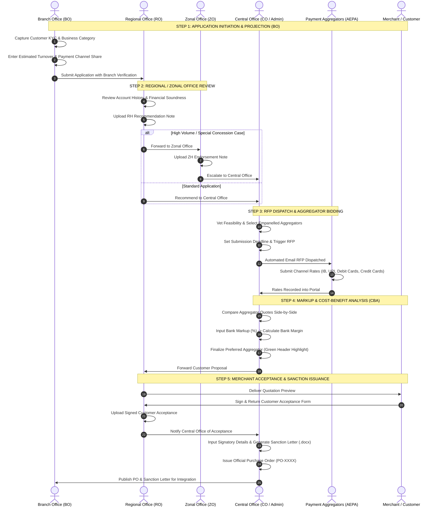

# Central Bank of India — Payment Aggregator Request Automation Portal (PAPG)
## Standard Operating Procedure (SOP) & Complete Workflow Manual

**Document Version:** 2.4.0  
**Target Organization:** Central Bank of India (CBI) — Digital Banking & Merchant Solutions  
**Applicable Roles:** Branch Office (BO), Regional Office (RO), Zonal Office (ZO), Central Office (CO/Admin), Empanelled Payment Aggregators (AEPA), Audit & Compliance Teams  
**Classification:** Confidential — Internal Banking Operations  

---

## Table of Contents
1. [Executive Summary & Regulatory Framework](#1-executive-summary--regulatory-framework)
2. [End-to-End Visual Workflow Swimlanes](#2-end-to-end-visual-workflow-swimlanes)
3. [Role-Based Access Control (RBAC) & Authority Matrix](#3-role-based-access-control-rbac--authority-matrix)
4. [Step-by-Step SOP — All Pages & Operational Modules](#4-step-by-step-sop--all-pages--operational-modules)
   - [4.1 Authentication & Admin Role Switcher](#41-authentication--admin-role-switcher)
   - [4.2 Central Dashboard & Application Flow Table](#42-central-dashboard--application-flow-table)
   - [4.3 Multi-Step Application Workflow Engine (Steps 1–5)](#43-multi-step-application-workflow-engine-steps-15)
     - [Step 1: Projection & Volume Estimation (BO/CO)](#step-1-projection--volume-estimation-boco)
     - [Step 2: Aggregator Selection & RFP Dispatch (CO)](#step-2-aggregator-selection--rfp-dispatch-co)
     - [Step 3: Commercial Quote Evaluation & Cost-Benefit Analysis (CBA) Matrix (CO)](#step-3-commercial-quote-evaluation--cost-benefit-analysis-cba-matrix-co)
     - [Step 4: Quotation Preview & Merchant Acceptance (RO/CO)](#step-4-quotation-preview--merchant-acceptance-roco)
     - [Step 5: Purchase Order (PO) Details & Sanction Letter Generation (CO)](#step-5-purchase-order-po-details--sanction-letter-generation-co)
   - [4.4 All Applications Repository & Multi-Criteria Filtering](#44-all-applications-repository--multi-criteria-filtering)
   - [4.5 Manage Aggregator Master Registry (CO Only)](#45-manage-aggregator-master-registry-co-only)
   - [4.6 Payment Aggregators Analytics & SLA Dashboard](#46-payment-aggregators-analytics--sla-dashboard)
   - [4.7 Help Desk & Support Ticketing System](#47-help-desk--support-ticketing-system)
   - [4.8 Standard Annexures & Policy Repository](#48-standard-annexures--policy-repository)
   - [4.9 Test Flow Simulation Sandbox](#49-test-flow-simulation-sandbox)
   - [4.10 Error Handling & System Recovery Protocols](#410-error-handling--system-recovery-protocols)
5. [Document Generation Specifications (Sanction Letter & PO)](#5-document-generation-specifications-sanction-letter--po)
6. [Exception Handling, Rejections & Audit Trail Governance](#6-exception-handling-rejections--audit-trail-governance)

---

## 1. Executive Summary & Regulatory Framework

The **Central Bank of India Payment Aggregator Request Automation Portal (PAPG)** is an automated enterprise workflow system designed to streamline the onboarding, commercial rate discovery, Cost-Benefit Analysis (CBA), quotation negotiation, and sanctioning of Payment Aggregator (PA) and Payment Gateway (PG) services for bank merchants and institutional clients.

### Key Objectives:
- **Compliance with RBI Guidelines**: Adheres strictly to the Reserve Bank of India (RBI) circular on *Regulation of Payment Aggregators and Payment Gateways*.
- **Multi-Vendor Rate Discovery**: Dispatches Request for Proposal (RFP) requests across empanelled aggregators (e.g., BillDesk, CCAvenue, Razorpay, Worldline, PayU, Paytm) to ensure competitive commercial rates.
- **Automated Cost-Benefit Analysis (CBA)**: Provides real-time calculations of Gross Merchant Discount Rate (MDR), Vendor Share, and Expected Bank Revenue across 11 transaction channels.
- **End-to-End Auditability**: Immutable audit trail timestamps for every approval, document upload, rate revision, and sanction issuance.

---

## 2. End-to-End Visual Workflow Swimlanes



---

## 3. Role-Based Access Control (RBAC) & Authority Matrix

The portal implements strict role-based access boundaries across the Central Bank of India hierarchy:

| Feature / Page | Branch Office (BO) | Regional Office (RO) | Zonal Office (ZO) | Central Office (CO) | Super Admin | Auditor / Read-Only (115019) |
|---|---|---|---|---|---|---|
| **Location Scope** | Assigned Branch | Assigned Region | Assigned Zone | All-India Master | All-India Master | All-India Master |
| **Create Application** | ✅ Full Access | ❌ No | ❌ No | ✅ Full Access | ✅ Full Access | ❌ Read Only |
| **Review & RH Note** | ❌ No | ✅ Full Access | ❌ No | ✅ Override | ✅ Full Access | ❌ Read Only |
| **Review & ZH Note** | ❌ No | ❌ No | ✅ Full Access | ✅ Override | ✅ Full Access | ❌ Read Only |
| **Select PAs & RFP** | ❌ No | ❌ No | ❌ No | ✅ Full Access | ✅ Full Access | ❌ Read Only |
| **Markup & CBA Table** | ❌ Masked | ❌ Masked | ❌ Masked | ✅ Full Access | ✅ Full Access | ❌ Read Only |
| **Customer Accept Upload**| ❌ No | ✅ Full Access | ❌ No | ✅ Full Access | ✅ Full Access | ❌ Read Only |
| **PO & Sanction Letter** | 👁️ View/Download | 👁️ View/Download | 👁️ View/Download | ✅ Generate & Issue | ✅ Full Access | 👁️ View Only |
| **Manage Aggregators** | ❌ No Access | ❌ No Access | ❌ No Access | ✅ Full Access | ✅ Full Access | ❌ No Access |
| **Help Desk Tickets** | 📝 Raise & View | 📝 Raise & View | 📝 Raise & View | ⚙️ Admin Resolve | ⚙️ Admin Resolve | 👁️ View Only |
| **Role Switcher** | ❌ No | ❌ No | ❌ No | ❌ No | ✅ Active | ❌ No |

---

## 4. Step-by-Step SOP — All Pages & Operational Modules

### 4.1 Authentication & Admin Role Switcher
- **URL Route:** `/login`
- **Objective:** Secure access via Employee PF ID and Password with environment-aware rendering.

#### Production Mode vs Development Mode Behavior:
- **Production Mode (`IS_PROD: true`)**:
  - Automatically hides all developer debug chips and role selector pills.
  - Presents an official Central Bank of India enterprise logon form with Employee PF ID & secure masked password fields.
  - Displays the regulatory **Information Security Advisory**:
    > *Protected Enterprise Banking Portal. All access is logged and verified under CBI Information Security Policy.*
  - Enforces Base64 encrypted credential transmission and automated user claims resolution.
- **Development Mode (`IS_DEV: true`)**:
  - Displays the **Dev Mode Quick Test User ID** suite (`139822 (CO Admin)`, `115019 (CO Admin)`, `CE25000014`, `CO1001`, `RO1001`, `ZO1001`, `BO1001`).
  - Displays instant role switches across `ADMIN`, `CO`, `RO`, `ZO`, `BO`.
  - For Super Administrators, the **Admin Role & Location Switcher Modal** enables seamless cross-jurisdiction testing.

```
┌────────────────────────────────────────────────────────────────────────┐
│ Admin Role & Location Switcher                                         │
│ ────────────────────────────────────────────────────────────────────── │
│ Active Role: [ Central Office (CO) ▼ ]                                 │
│ Zone Scope:  [ West Zone ▼ ]                                           │
│ Region Scope:[ Mumbai Region ▼ ]                                       │
│ Branch Scope:[ Chembur Branch (1002) ▼ ]                               │
│                                                                        │
│ [ Cancel ]                                         [ Apply Scope (✔) ] │
└────────────────────────────────────────────────────────────────────────┘
```

---

### 4.2 Central Dashboard & Application Flow Table
- **URL Route:** `/dashboard`
- **Objective:** Centralized executive dashboard displaying active merchant pipelines, status counts, and real-time application tables.

#### Table Layout & UI Enhancements:
1. **Customer / Institution Column**: Displays the Customer Name with a prominent **NEW** badge for new-to-bank customers.
2. **Account Number Column**: Displays verified 14-digit CBI Account Number, or an orange `NA` chip if the account opening is currently under process.
3. **Category Column**: Structured two-line layout displaying the primary **Category** (e.g., *Government / Education*) and the **Business Category** subtitle (e.g., *Educational Institution*).
4. **Action Menu Dropdown**: When an application reaches completion, action items are consolidated into a clean, modern **Action** dropdown:
   - **Application Flow**: Opens the full 5-step workflow dialog.
   - **Audit Trail**: Opens the detailed chronological timestamp modal.
   - **Download PO**: Generates and downloads the official Purchase Order document.
   - **Cost-Benefit Analysis**: Opens the comparative CBA evaluation matrix.
   - **Sanction Letter**: Instantly downloads the official `.docx` Sanction Letter.

---

### 4.3 Multi-Step Application Workflow Engine (Steps 1–5)

#### Step 1: Projection & Volume Estimation (BO/CO)
- **Actor:** Branch Office (BO) during creation, Central Office (CO) during review.
- **Key Inputs:**
  - Annual Estimated Transaction Volume (in ₹ Lakhs/Crores).
  - Average Ticket Size (in ₹).
  - Percentage Share across Channels:
    - *Internet Banking (SBI, HDFC, ICICI, AXIS, Others)*
    - *UPI (Unified Payments Interface)*
    - *Debit Cards (Rupay, Master/Visa ≤ ₹2,000, Master/Visa > ₹2,000)*
    - *Credit Cards (Domestic & International)*
- **Mandatory Document Uploads:** Customer KYC Identification Document & Duly Signed Merchant Application Form.

---

#### Step 2: Aggregator Selection & RFP Dispatch (CO)
- **Actor:** Central Office (CO) / Admin.
- **Procedure:**
  1. CO evaluates the merchant's projected volume and technical requirements (e.g., Shopify plugin, ERP SDK, e-NACH).
  2. Selects candidate Payment Aggregators from the empanelled list (multi-select checkboxes).
  3. Sets the **RFP Submission Cutoff Date & Time**.
  4. Clicks **Dispatch RFP Quotation Request**. Automated email dispatches with secure rate-entry links are issued to selected vendors.

---

#### Step 3: Commercial Quote Evaluation & Cost-Benefit Analysis (CBA) Matrix (CO)
- **Actor:** Central Office (CO).
- **Procedure:**
  1. Once aggregators submit their commercial quotes, CO enters the proposed **Bank Markup Charges (%)**.
  2. The system automatically executes the CBA formula:
     $$\text{Gross Amount} = \text{Annual Volume} \times \text{Gross MDR Rate}$$
     $$\text{Vendor Commission Share} = \text{Annual Volume} \times \text{Aggregator Rate}$$
     $$\text{Expected Revenue to Bank} = \text{Gross Amount} - \text{Vendor Share}$$
  3. **Visual Color Coding in CBA Modal**:
     - **Green Header Column**: Selected / Finalized Aggregator.
     - **Red Header Columns**: Other participating rejected aggregators.
  4. Click **Finalize & Approve Aggregator** to lock the commercial quotation.

---

#### Step 4: Quotation Preview & Merchant Acceptance (RO/CO)
- **Actor:** Regional Office (RO) & Merchant.
- **Procedure:**
  1. RO downloads the finalized **Customer Quotation Proposal**.
  2. Presents the commercial rates to the merchant for formal acceptance.
  3. Merchant signs and stamps the acceptance letter.
  4. RO uploads the **Signed Customer Acceptance Document** and clicks **Submit Customer Acceptance**.

---

#### Step 5: Purchase Order (PO) Details & Sanction Letter Generation (CO)
- **Actor:** Central Office (CO).
- **Procedure:**
  1. CO enters the official PO details:
     - *Authorised Person Name & Designation*
     - *Regional Commercial Cell (RCC) Contact Person, Phone & Email*
     - *Branch Location & Delivery Terms*
  2. Clicks **Generate PO & Sanction Letter**.
  3. The system generates:
     - **Sanction Letter (.docx)**: Pre-filled official document on Central Bank of India letterhead with reference numbers, terms of sanction, and commercial schedule.
     - **Purchase Order (.pdf/.docx)**: Official procurement PO issued to the finalized payment aggregator with unique `PO-XXXX` identifier.
  4. The application state transitions to **Completed (Final Approval)**.

---

### 4.4 All Applications Repository & Multi-Criteria Filtering
- **URL Route:** `/applications`
- **Objective:** Master database of all historic and active merchant applications across India.
- **Features:**
  - Filter by Zone, Region, Branch, Application Status, and Business Category.
  - Search by Customer Name, Account Number, or Aggregator Name.
  - One-click **Export to Excel (`.xlsx`)** and **Print Summary Report**.

---

### 4.5 Manage Aggregator Master Registry (CO Only)
- **URL Route:** `/manage-aggregrator`
- **Objective:** Master database of empanelled Payment Aggregators and Payment Gateways.
- **Capabilities:**
  - Add New Payment Aggregator (Entity Name, Contact Person, Email, Alternate Email, Mobile).
  - Configure Supported Channel Services (UPI, IB, Credit/Debit, BBPS, POS).
  - Status Management (Active, Inactive, Suspended).
  - Security Controls: View failed login attempts, trigger password reset, unlock locked vendor accounts.

---

### 4.6 Payment Aggregators Analytics & SLA Dashboard
- **URL Route:** `/aggregrator-dashboard`
- **Objective:** Real-time vendor performance, quote response turnaround times, and contract validity tracking.
- **Key Metrics:**
  - Active vendor agreement validity periods and upcoming expiration alerts.
  - Average RFP turnaround time (TAT) per vendor.
  - Conversion success rate of quotations per aggregator.

---

### 4.7 Help Desk & Support Ticketing System
- **URL Route:** `/helpdesk`
- **Objective:** Internal resolution of branch queries, aggregator discrepancies, and merchant rate disputes.
- **Workflow:**
  1. Branch/Region creates a ticket with Category, Customer Account Number, Priority (*Low / Medium / High / Critical*), and Description.
  2. Central Office Helpdesk team receives real-time notification.
  3. CO updates status to *In Progress*, appends resolution remarks, and moves to *Resolved*.

---

### 4.8 Standard Annexures & Policy Repository
- **URL Route:** `/annexures`
- **Objective:** Centralized library of standard compliance templates, regulatory circulars, and agreements.
- **Available Documents for Instant Download:**
  - *Annexure A*: Merchant Payment Aggregator Request Form.
  - *Annexure B*: RH / ZH Recommendation Note Format.
  - *Annexure C*: Standard Tripartite Merchant-Bank-Aggregator Agreement.
  - *Annexure D*: RBI PA/PG Guidelines & Circulars.

---

### 4.9 Test Flow Simulation Sandbox
- **URL Route:** `/test-flow`
- **Objective:** Sandbox environment enabling staff training, testing of complex volume scenarios, and rapid UAT validation across all 5 workflow stages without impacting live production data.

---

### 4.10 Error Handling & System Recovery Protocols
- **403 Access Denied (`/403`)**: Triggered when a user attempts to access an unauthorized tier (e.g., BO accessing Manage Aggregators). Redirects to Dashboard.
- **404 Not Found (`/404`)**: Catch-all for non-existent routes with quick navigation back to home.
- **500 Server Error (`/500`)**: Graceful crash screen with error tracking ID and reload button.
- **Service Down / Maintenance (`/service-down`, `/maintenance`)**: Scheduled maintenance screen.

---

## 5. Document Generation Specifications (Sanction Letter & PO)

### Official Sanction Letter Format (.docx)
The Sanction Letter generated in Step 5 includes the following automated sections:
1. **Header**: Central Bank of India Emblem, Central Office Address, Digital Banking Division.
2. **Reference Number**: `CBI/CO/DBD/PAPG/{YYYY}/{ApplicationId}`.
3. **Recipient**: Merchant Name, Registered Office Address, Contact Person.
4. **Preamble**: Confirmation of approval for Payment Aggregator integration.
5. **Approved Commercial MDR Schedule Table**: Channel-by-channel breakdown (IB, UPI, Debit Card, Credit Card) with agreed transaction rates.
6. **Settlement Terms**: T+1 / T+2 settlement cycle, chargeback guidelines, escrow account details.
7. **Signatory**: Authorized Bank Executive Name, Designation, and Central Office Seal.

---

## 6. Exception Handling, Rejections & Audit Trail Governance

### Rejection Workflows
- If an application is rejected at any level (RO, ZO, or CO):
  1. The reviewer must select a **Rejection Reason Category** and provide detailed **Remarks**.
  2. The application status immediately updates to `rejectedbyro`, `rejectedbyzo`, or `rejectedbyco`.
  3. The initiating branch receives immediate notification with the recorded rejection grounds.

### Audit Trail Logging
Every single transaction, state change, quote submission, markup update, document upload, and download action records:
- **Timestamp (IST)**
- **User PF ID & Name**
- **Action Type & Changed Attributes**
- **IP Address & Session Hash**
- Accessible at any time via the **Audit Trail** button in the application action menu.

---

*End of Standard Operating Procedure (SOP) Manual.*  
*Central Bank of India — Payment Aggregator Request Automation Portal (PAPG)*
