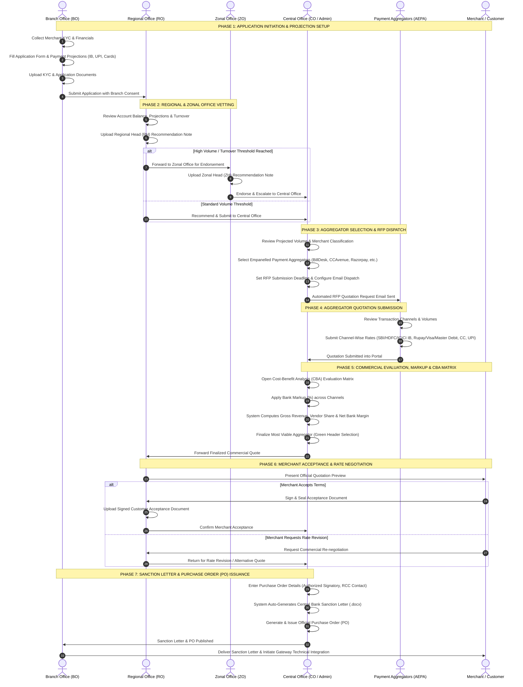
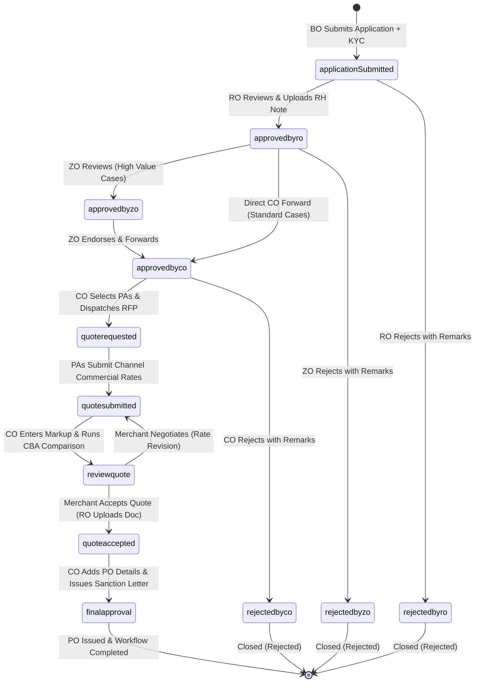
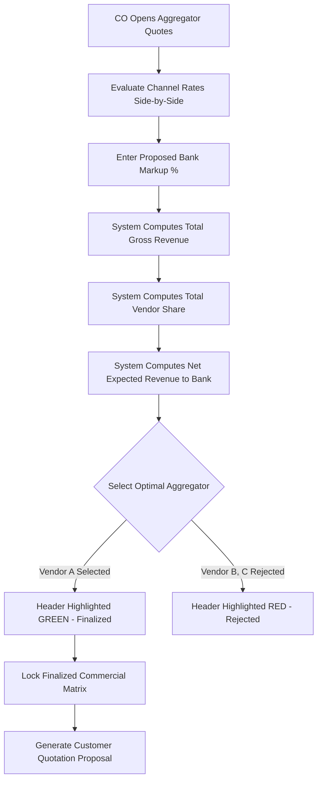
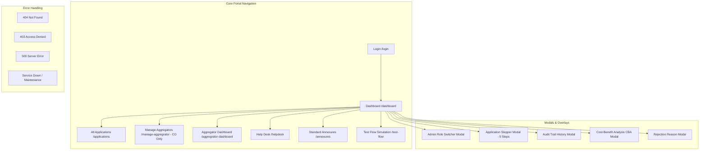

# Central Bank of India — PAPG Workflow Diagrams & Visual Architecture Repository

This repository contains the complete set of visual process flows, swimlane diagrams, state transition models, and system architecture blueprints for the **Payment Aggregator Request Automation Portal (PAPG)**.

---

## 1. Master Multi-Role Swimlane Workflow Diagram

This swimlane diagram illustrates the end-to-end operational lifecycle and inter-departmental task handoffs across all organizational tiers of Central Bank of India and external Payment Aggregators.



---

## 2. Application State Machine Lifecycle Diagram

The portal manages application progression through 10 distinct status states with strict validation gates:



---

## 3. Cost-Benefit Analysis (CBA) Matrix Decision Flowchart



---

## 4. Sanction Letter & Document Generation Flow

```mermaid
flowchart LR
    subgraph Data Layer
        A1[Customer Details & Account No]
        A2[Finalized Aggregator Name & ID]
        A3[Commercial Rates & Markup Matrix]
        A4[Authorized Signatory & RCC Person]
    end

    subgraph Generation Engine
        B1[Central Bank Official Template Header]
        B2[Dynamic Word .docx Builder]
        B3[Purchase Order PDF Generator]
    end

    subgraph Output Artifacts
        C1[Official Sanction Letter .docx]
        C2[Central Bank Purchase Order PO-XXXX]
        C3[Audit Trail Timestamp Record]
    end

    Data Layer --> Generation Engine
    Generation Engine --> Output Artifacts
```

---

## 5. System Route & Module Architecture


